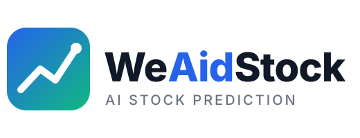

<div align="center">



# WeAidStock

**AI 멀티 에이전트 · 온톨로지 · JEV 판단 기반 한국 주식(KOSPI/KOSDAQ) 분석 터미널**

[](https://github.com/666ghj/MiroFish)
[](https://www.python.org/)
[](https://vuejs.org/)
[](https://flask.palletsprojects.com/)
[](./LICENSE)

</div>

---

## 개요

종목 하나를 고르면 **데이터 수집 → 리서치 → 에이전트 시뮬레이션 → 증권사 형식 리포트 → 지식그래프(온톨로지) → 투자위원회 토론 → JEV 확률 판단**까지 한 번에 진행하고, 매매전략·기술적 분석 결론을 **%** 로 제시합니다.

```
1 종목 선택 → 2 분석 & 시뮬레이션 → 3 예측 보고서 → 4 지식그래프 → 5 판단
```

| 단계 | 내용 | 핵심 기술 |
|---|---|---|
| **1·2 분석·리서치** | 네이버 일봉·재무·**증권사 컨센서스**(목표주가 평균·선행 EPS) 수집, 리플렉션 루프 리서치(계획 → 검색 → 사실 추출 → 부족한 부분 재검색 ×2): 국내 뉴스·공시·해외 뉴스, **주장마다 출처 URL** | Google News RSS, 네이버 증권, OpenDART(선택), Tavily(선택) |
| **2 감성·시뮬레이션** | 다국어 감성 모델(`tabularisai/multilingual-sentiment-analysis`, CPU) + Grok 앙상블, 근거(뉴스 감성·모멘텀·PER)를 반영한 50명 에이전트 투표 | transformers, xAI Grok |
| **3 리서치 리포트** | 투자요약·투자포인트·실적·밸류에이션(선행 PER)·기술적 분석·컨센서스·리스크·투자의견 8개 섹션, **섹션별 JSON 검증·재작성**, SVG 차트, PDF/Markdown 저장 | grok-4.7 |
| **4 지식그래프** | Palantir Foundry 방식 **Semantic·Kinetic·Dynamic** 3계층, CQ(핵심 질문)·ADR(의사결정 기록), **RDF/OWL2(Turtle)**, d3.js 2D 편집 · three.js 3D · S-P-O 표, 인사이트 음성(xAI TTS) | d3, three.js |
| **5 판단** | **투자위원회 토론**(강세·약세·리스크 매니저·의장, 2~3라운드, 사실표 기반 정정) → **JEV(TypeSafe) 보정 확률**로 방향·전략·기술 명제·CQ·ADR·쟁점 채점 → 매매계획(진입·목표·손절·비중, 변동성 기반 자동 보정) | JEV, Grok |

### 대시보드 (첫 화면)
- KOSPI·KOSDAQ·글로벌 지수(Yahoo Finance)·가상자산(CMC)·뉴스·증시 일정
- **오늘의 테마**: 평일 08:40 자동 추출(Grok 선정 + 뉴스 근거), 테마 구성 종목 → 스크리너 연동
- **영웅문 스타일 조건 검색**: 조건식(A and (B or C) …) · 프리셋 · 추천

### 설정 화면 (`/settings`, 이 PC 에서만 열림)
API 키 입력·연결 테스트(앞뒤 4자리만 표시, 저장 전 `.env.bak` 백업), 백엔드 재시작, 감성 모델 설치, 로그 보기, 네트워크 진단(`/api/admin/netdiag`), 화면 서버 포트 관리.

---

## 실행 (Windows)

### 사전 요구사항
- Python 3.12 (가상환경 `backend/.venv`), Node.js 18+
- xAI API 키(필수), TypeSafe JEV 키 또는 Vercel AI Gateway 키(판단), Zep 키(시뮬레이션 랩)

### 설치
```bash
npm run setup           # 프론트엔드 의존성
npm run setup:backend   # 백엔드 의존성 (uv / pip)
cp .env.example .env    # 키 입력 — 이후에는 설정 화면에서 관리
```

### 시작 / 재시작
```
restart-backend.bat     (백엔드 5001 재시작 + 화면 서버가 꺼져 있으면 3300 으로 기동)
start-local.ps1         (처음 시작)
```
- 화면: **http://localhost:3300** (대시보드) · `/stock` (5단계 분석) · `/settings`
- 백엔드: http://127.0.0.1:5001 (이 PC 에서만)
- 화면 포트 변경: 환경변수 `WEAID_WEB_PORT` (사용 중이면 다음 번호로 자동 이동)

### 주요 환경변수 (`.env`)
| 키 | 용도 |
|---|---|
| `XAI_API_KEY` | Grok 보고서·지식그래프·토론·감성·TTS |
| `TYPESAFE_API_KEY` / `AI_GATEWAY_API_KEY` | JEV 판단 (TypeSafe 직접 경로 우선) |
| `LLM_PROVIDER`, `XAI_LLM_MODEL`, `XAI_FAST_MODEL` | 모델 선택 (기본 grok-4.7 / 최신 non-reasoning) |
| `DART_API_KEY`, `TAVILY_API_KEY`, `YOUTUBE_API_KEY` | 공시·해외 검색·유튜브 댓글 (선택) |
| `SENTIMENT_MODE` | `auto`(Grok 70% + 로컬 30%) · `local` · `llm` · `lexicon` · `off` |
| `COMMUNITY_SOURCES` | `naver` · `youtube` · `off` — robots.txt 가 막으면 자동 생략 |
| `RESEARCH_ROUNDS`, `RESEARCH_TIME_BUDGET` | 리플렉션 횟수(기본 2) · 시간 한도(기본 150초) |
| `THEME_SCHEDULE`, `THEME_SCHEDULE_TIME`, `THEME_LLM` | 오늘의 테마 자동 추출 (기본 on · 08:40 · auto) |

### 원격 접속 (stock.webig.ai · Cloudflare Tunnel)
PC 에서 돌고 있는 WeAidStock 을 공개 주소로 엽니다. PC 가 켜져 있고 백엔드가 실행 중일 때만 접속됩니다.
```
방문자 → Cloudflare(stock.webig.ai) → 터널 weaidstock → 이 PC 의 cloudflared → 백엔드 127.0.0.1:5001 (빌드된 화면 + API)
```
1. 설정 → 원격 접속 카드 → **빌드** (화면을 `frontend/dist` 로 만들어 백엔드가 직접 서빙)
2. Cloudflare Zero Trust → Networks → Tunnels → `weaidstock` → 커넥터 설치 명령 복사 → 설정의 **Cloudflare 터널 토큰**에 붙여 넣고 저장
3. 원격 접속 카드 → **내려받고 연결** (cloudflared 공식 릴리스를 `backend/bin` 에 받아 실행, 이후 백엔드와 함께 자동 실행)

보안
- **Cloudflare Access** 가 공개 주소 앞에서 막습니다 — 정책 `WeAidStock - owner`(허용 이메일)로 일회용 코드 로그인, 세션 7일. `/health` 만 우회.
- 앱도 Access 가 붙여 준 JWT(`Cf-Access-Jwt-Assertion`)를 RS256 서명·aud·iss·만료까지 검증합니다(`REMOTE_ACCESS=access`, 기본). Access 를 거치지 않은 요청(같은 와이파이에서 5001 직접 접속 등)은 차단됩니다.
- 설정·관리 API(`/api/admin/*`)는 원격에서 항상 403. 원격 판정은 `CF-Connecting-IP` 등 프록시 헤더로도 합니다. Werkzeug 디버거는 꺼져 있습니다.
- 다른 방식: `code`(앱 자체 접속 코드 로그인 — 쿠키 30일, 15분에 8회 실패 시 잠금) · `open`(권장하지 않음) · `off`.

---

## 구조

```
backend/app/
├── api/
│   ├── stock.py        5단계 파이프라인 · 작업 진행(SSE) · 리서치
│   ├── committee.py    투자위원회 토론
│   ├── market.py       대시보드 · 스크리너 · 오늘의 테마
│   └── admin.py        로컬 전용 설정·재시작·진단
├── services/
│   ├── stock_research.py        리플렉션 리서치 에이전트
│   ├── sentiment.py / community.py
│   ├── stock_report_agent.py    증권사 리포트 템플릿 + 검증
│   ├── stock_knowledge_graph.py Foundry 3계층 온톨로지 · RDF/OWL2 · TTS
│   ├── stock_committee.py       토론 (사실표 인용·정정)
│   ├── stock_decision.py        JEV 판단 · 매매계획
│   ├── stock_evidence.py        공통 사실표(F#/R#/C#/K#)
│   ├── market_data.py / stock_screener.py / theme_service.py / theme_scheduler.py
└── utils/resilience.py          429·5xx 재시도 · JSON 복구
frontend/src/
├── views/      Dashboard · StockPrediction · Settings
└── components/ ProgressModal · ResearchPanel · ResearchReport · KnowledgeGraphStep · Graph3D
                CommitteeDebate · DecisionStep · ThemePanel
```

---

## 데이터 이용 원칙
- 네이버 증권 도메인의 robots.txt 는 일반 봇을 전면 금지합니다. **종목토론실 수집은 robots.txt 를 실행 시점에 확인해 자동 생략**하며, 그 밖의 시세·뉴스 조회는 사용자가 요청한 소량·개인 용도로만 사용합니다. 오늘의 테마 자동 추출은 설정에서 끌 수 있습니다.
- 커뮤니티 글은 작성자 정보를 저장하지 않으며, 사실이 아닌 참고용 심리 지표로만 씁니다.

## ⚠️ 면책
AI 시뮬레이션·확률 모델 기반의 참고 정보이며 투자 권유가 아닙니다. 같은 종목도 실행마다 리서치·토론 결과가 달라질 수 있으니 여러 번의 결과를 비교해 보시기 바랍니다. 최종 투자 결정과 책임은 투자자 본인에게 있습니다.

## 라이선스 · 감사
- [AGPL-3.0](./LICENSE) — 원본 [MiroFish](https://github.com/666ghj/MiroFish) 라이선스를 따릅니다.
- [OASIS](https://github.com/camel-ai/oasis), [Zep](https://www.getzep.com/), [pykrx](https://github.com/sharebook-kr/pykrx), TypeSafe JEV, xAI Grok.
- 투자위원회·리플렉션 리서치·감성 모델 아이디어는 BettaFish 를 참고했으나 코드는 사용하지 않았습니다(라이선스 비호환).
